<!-- Terminal-window header (custom animated SVG, lives in /assets) -->
<p align="center">
  
</p>

<p align="center">
  
</p>

---

### `$ cat about.yaml`

```yaml
role: MSc Data Science & Computer Science Graduate @ ESILV Paris
location: France
background: Full-Stack Software Engineering → Data Science & AI
focus: Machine Learning, LLMs, RAG & MLOps
recent_project: Credit Risk Modeling System (Scikit-learn, FastAPI, MLflow, Docker)
currently_learning: [MLOps, NLP, RAG evaluation, AI engineering]
open_to: [AI/ML engineering opportunities, Data projects, collaborations]
```

<p>
  <a href="mailto:udhayakumar2352001@gmail.com">
    
  </a>
  <a href="https://www.linkedin.com/in/udhayakumar-velou-758723172/">
    
  </a>
</p>

<!-- <p align="center"> -->
  <!--  -->
<!-- </p> -->

---

### `$ ls ~/tech-stack`

**languages**
<p align="left">
  
</p>

**ml / data**
<p align="left">
  
  
  
  
  
  
  
</p>

**frontend**
<p align="left">
  
</p>

**backend**
<p align="left">
  
</p>

**mlops / devops**
<p align="left">
  
</p>

**databases**
<p align="left">
  
</p>

---

### `$ git stats --me`

<p align="center">
  
</p>

<p align="center">
  
  
</p>

<p align="center">
  
</p>

---

<!-- Animated terminal footer (custom SVG, lives in /assets) -->
<p align="center">
  
</p>
